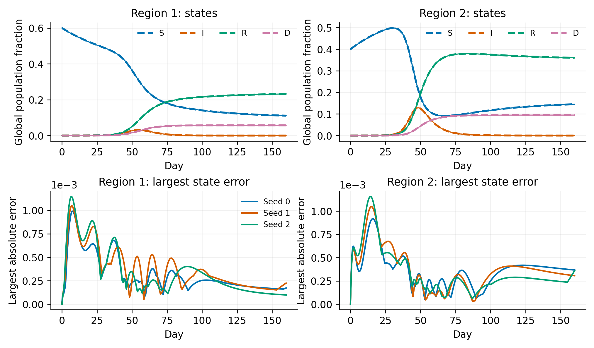

# Disease-Informed Neural Networks for Epidemic Dynamics and Population Mobility

Reproducible SIRD parameter estimation and two-region synthetic benchmarks

**Kingsley Chimuanya Ukandu**

This project estimates disease and population movement rates by fitting neural epidemic trajectories to synthetic observations and differential equations. It includes the original SIRD notebook, a separate implementation with exact state constraints, and a two-region SIRD model with directional movement.

The recorded experiments recover known rates with small errors and retain every final initialization seed. Direct ODE calibration is more accurate on these benchmarks. The work provides an implementation and reproducible validation records for further research; it does not establish performance on real surveillance or mobility data.

Start with the [project report](docs/report/project_report.md) for the methods and findings. The DINN framework comes from [Shaier, Raissi, and Seshaiyer (2022)](https://arxiv.org/abs/2110.05445v3).

## Check the recorded results

From this repository's root, use Python 3.12 and a separate environment. The activation command below is for Linux or macOS.

```bash
python3.12 -m venv .venv
source .venv/bin/activate
python -m pip install -r requirements.txt
python scripts/verify_recorded_results.py
```

On Windows PowerShell, create the environment with `py -3.12 -m venv .venv` and activate it with `.venv\Scripts\Activate.ps1`.

The verifier checks the preserved original notebook, historical source and observation hashes, all **21 later neural checkpoints**, and **seven ODE calibration objectives**. It recomputes checkpoint diagnostics and the three single-region forecast errors without retraining or changing recorded results. A successful run prints `PASS`.

The [two-region notebook](notebooks/two-region-sird-dinn.ipynb) loads the recorded clean seed-0 checkpoint by default. The [original notebook](notebooks/sird-dinn.ipynb) is retained unchanged. See the [recorded environment](docs/reproduction/environment.md) for dependencies and execution settings.

## Completed work

| Stage | Implementation and checks | Recorded runs |
| --- | --- | --- |
| Original SIRD | Preserved public notebook; independent reproduction and state diagnostics | Two fresh-process runs with the same seed |
| Constrained SIRD | Nonnegative states, exact initial state, population sum one; clean, noisy, missing, and chronological holdout conditions | 12 neural fits and four ODE calibrations |
| Two-region SIRD | Six disease rates and two movement rates; balance, limiting-case, solver, and derivative checks | Nine neural fits and three ODE calibrations |

All experiments reported here are dated **October 11, 2026**. The original notebook was already present in the public source version dated **June 19, 2026**. The later experiments are distinct from that earlier version. Development pilots remain separate from final validation totals.

## Models and assumptions

SIRD tracks susceptible, infected, recovered, and cumulative deceased population fractions. Transmission, recovery, and disease death rates are positive trainable parameters.

The original network uses an unconstrained linear output. The later networks mix the known initial state with a softmax output through the gate `g(t) = 1 - exp(-t/3.2)`. This gives nonnegative states, the exact initial state, and a total population fraction of one for nonnegative time. Differential equations are enforced through a weighted residual loss and remain approximate.

In the two-region model, all eight states use the **combined initial population** as their unit. Incidence in region `j` is `beta_j * S_j * I_j / p_j`, with fixed reference fractions `p1 = 0.6` and `p2 = 0.4`. Regional totals can change through movement. `tau12` moves people from region 1 to region 2; `tau21` moves people from region 2 to region 1. Each directional rate applies to S, I, and R. Deceased states do not move.

All states and the initial conditions are observed or known in the final benchmarks. Each noisy or missing case has one fixed dataset shared by seeds 0, 1, and 2. Gaussian noise is added without clipping or renormalizing observations. Seed variation reflects network initialization, not statistical uncertainty.

## Results

The original SIRD reproduction recovered the three rates below 0.1% absolute relative error:

| Rate | Truth per day | Recovered per day | Error % |
| --- | ---: | ---: | ---: |
| beta | 0.50000000 | 0.50016302 | 0.032604 |
| gamma | 0.20000000 | 0.20001969 | 0.009844 |
| omega | 0.07142857 | 0.07149749 | 0.096479 |

The original output also has 46 negative entries on the 641-point diagnostic grid and a maximum population sum error of 0.00158. These limits motivated the separate constrained implementation.

The two-region results below include all three seeds for each case:

| Case | Worst disease rate error % | Worst movement rate error % | DINN trajectory RMSE range | ODE trajectory RMSE |
| --- | ---: | ---: | ---: | ---: |
| Clean | 0.265 | 0.438 | 0.000237 to 0.000261 | 3.43e-15 |
| Noisy | 2.15 | 1.03 | 0.000359 to 0.000368 | 0.000105 |
| Missing | 0.340 | 0.649 | 0.000246 to 0.000268 | 2.81e-15 |

Absolute relative rate error is `100 * abs(estimate - truth) / truth`. Trajectory RMSE averages squared errors over all states and 641 times on days 0-160, then takes the square root. Rate-error columns show maxima across the applicable rates and all three seeds. The ODE comparator has one calibration per dataset.



Solid state curves are neural fits; dashed curves are synthetic ODE truth. The lower panels show the largest absolute state error in each region. See the [figure captions and source files](results/presentation/2026-10-11/captions.md).

Across all 21 constrained neural fits, diagnostic states are nonnegative, initial-state error is zero, and the largest population sum error is 4.44e-16. Equation residuals remain nonzero. Some single-region recovered/deceased curves and two-region deceased curves have small negative derivatives. Regional recovered states can decrease through outward movement. State constraints alone do not enforce monotonicity.

The single-region forecast test uses observations and equation points only through day 60, then integrates the SIRD equations with the inferred rates for days 61-88. All-state forecast RMSE ranges from 0.000416 to 0.00118 across the three seeds, compared with 0.157 for day-60 persistence and 2.51e-12 for direct ODE calibration. This is one clean synthetic cutoff; the two-region study has no forecast benchmark.

The [exact result tables](results/presentation/2026-10-11/) retain unrounded estimates, every seed, comparators, and constraint diagnostics. The [project report](docs/report/project_report.md) explains the results and their interpretation.

## Reproduce an experiment

Use the model-specific instructions to prepare observations, fit ODE baselines, train every seed, and summarize a fresh run:

- [Original SIRD reproduction](docs/reproduction/original.md)
- [Constrained SIRD experiments](docs/reproduction/sird.md)
- [Two-region mobility experiments](docs/reproduction/two_region.md)

New experiment outputs belong in `runs/` and are excluded from version control. Recorded experiment directories are protected from overwrite by the runners. Training budgets, seeds, observation designs, and source hashes are recorded in each protocol. The original uses float32; later models use float64. Dependency pins and fixed seeds support reproduction but do not guarantee identical floating-point results on every platform.

To regenerate the presentation figures and tables from saved records, without training, choose a fresh output directory:

```bash
python scripts/build_presentation_assets.py --output runs/presentation_review
```

## Repository guide

| Location | Contents |
| --- | --- |
| [src/](src/) | Single-region and two-region equations, neural models, and output-path protection |
| [notebooks/](notebooks/) | Original notebook and two-region walkthrough |
| [scripts/](scripts/) and [tests/](tests/) | Reproduction runners, verification, figure builder, and mathematical checks |
| [data/synthetic/](data/synthetic/) | Exact observations used by the recorded experiments |
| [results/](results/) | Protocols, checkpoints, trajectories, baselines, and result tables |
| [figures/](figures/) | Original recorded plots and presentation derivatives |
| [docs/](docs/) | Project report, reproduction instructions, and provenance records |
| [archive/](archive/) | Earlier source versions, executed reproduction notebooks, and development records |

The [structure notes](docs/project_structure.md) describe the dated folders in detail.

## Limits and further research

The experiments use correctly specified synthetic equations, fully observed states, and known initial conditions. They do not test real surveillance, empirical mobility, uncertainty intervals, or operational forecasting. Direct ODE calibration has lower overall trajectory RMSE in every full-window benchmark and lower holdout RMSE in the forecast test.

Identifiability requires separate attention. Observing only S and I cannot separate gamma from omega in the single-region model. Equal, symmetric regions can leave the common movement scale unidentified. Full local numerical Jacobian rank for the chosen two-region data is not a proof of global identifiability.

Further work will examine partial observations, repeated noise realizations, uncertain initial states, and time-varying rates against the same ODE baseline. Extension to SIS patch models and empirical data remains future work.

## Version history and attribution

The original source is pinned at commit [`3c6275393c7f2aea437683c0e077996e6bff5d45`](https://github.com/kingsleyukandu/dinn-epidemic-mobility/tree/3c6275393c7f2aea437683c0e077996e6bff5d45). Its notebook remains byte-identical to Git blob `2585e90aba6c964101b55e642a62279ea3318ece`. The [earlier README](archive/2026-10-11/source/README.md) is retained with the historical source. [Provenance records](docs/provenance/) connect archived files, current paths, and SHA-256 hashes.

Shaier, S., Raissi, M., and Seshaiyer, P. (2022). *Data-driven approaches for predicting spread of infectious diseases through DINNs: Disease Informed Neural Networks.* Letters in Biomathematics, 8(1), 71-105. [arXiv version](https://arxiv.org/abs/2110.05445v3).

This project applies that framework to the implementations and synthetic benchmarks documented here.
