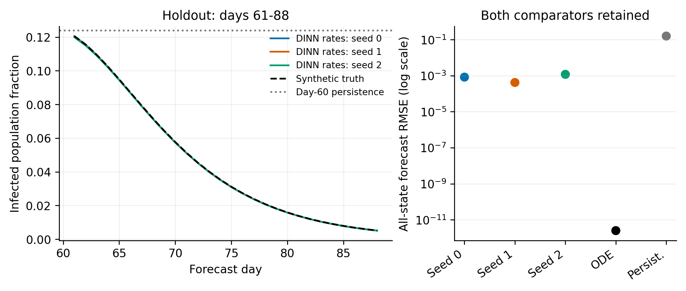

# Disease-Informed Neural Networks for Epidemic Dynamics and Population Mobility

Reproducible SIRD parameter estimation and two-region synthetic benchmarks

Kingsley Chimuanya Ukandu | October 11, 2026

## Purpose and scope

This project examines whether a neural representation of epidemic trajectories can recover known disease and movement rates while respecting the accounting rules of a compartmental model. It applies the disease-informed neural network approach described by Shaier, Raissi, and Seshaiyer [1]. The work presented here consists of a reproducible SIRD implementation, a separate implementation with exact state constraints, and a two-region extension with directional movement.

The experiments recover rates with small errors on controlled synthetic data. They also expose an important limit: direct calibration of the same differential equations is more accurate on these benchmarks. The results therefore establish an implementation and a set of checks for further research, rather than an advantage over established parameter estimation methods. Every dataset in this report is generated from a known model.

## Original SIRD implementation

S, I, R, and D denote susceptible, infected, recovered, and cumulative deceased fractions of the initial population. The rates β, γ, and ω describe transmission, recovery, and disease death. With time measured in days, the single-region equations are

$$
S^{\prime}=-\beta SI,\quad I^{\prime}=\beta SI-(\gamma+\omega)I,\quad R^{\prime}=\gamma I,\quad D^{\prime}=\omega I.
$$

The preserved notebook has three hidden layers of 32 tanh units and an unconstrained linear output. It fits 54 observations at three-day intervals over days 0-159, with 161 equation evaluation points through day 160. Adam performs 20,001 updates in float32. The public source version is dated June 19, 2026; the two fresh-process reproductions and all later validation runs are dated October 11, 2026 [S1].

| Rate | Truth per day | Recovered per day | Relative error % |
| --- | --- | --- | --- |
| beta | 0.50000000 | 0.50016302 | 0.032604 |
| gamma | 0.20000000 | 0.20001969 | 0.009844 |
| omega | 0.07142857 | 0.07149749 | 0.096479 |

Table 1. Original reproduction, run 1. Errors are 100 times the absolute estimate-minus-truth difference divided by truth. The two fresh processes produced identical recorded metrics.

All three rate errors are below 0.1%. The state fit is less exact: 46 of 2,564 evaluated entries are negative, and the largest population sum error is 0.00158. The maximum ODE residual is 0.000435 per day. These diagnostics explain why rate recovery alone is insufficient to assess the implementation.

## Constrained SIRD validation

The second implementation changes the state representation so that the neural prediction begins at the known initial state, remains nonnegative, and sums to one. If zθ(t) is the vector of network logits and y₀ is the initial state, the prediction is

$$
y_{\theta}(t)=(1-g(t))y_0+g(t)\,\operatorname{softmax}(z_{\theta}(t)),\quad g(t)=1-e^{-t/3.2}.
$$

For nonnegative time this is a convex mixture of two population vectors. The three state properties are exact in the mathematical construction, up to floating-point arithmetic in computation. Rates are exponentials of trainable log rates. The governing equations enter through a squared residual penalty, so their satisfaction remains approximate.

Training minimizes the observation mean squared error plus 10⁻⁴ times the equation mean squared error. Equation derivatives are taken with respect to normalized time τ = t/T; residuals reported here are converted back to units per day. The original initial-condition penalty is unnecessary in this implementation because the initial state is built into the output [S2].

| Experiment | Observation design | Neural fits |
| --- | --- | --- |
| Clean | 54 times through day 159 | 3 seeds |
| Noisy | Same times; Gaussian noise σ = 0.002 | 3 seeds |
| Missing | 38 retained times; endpoints preserved | 3 seeds |
| Forecast | 21 times through day 60; holdout days 61-88 | 3 seeds |

Table 2. Noise is added without clipping or renormalizing observations. Its level is a population fraction. Each imperfect-data case has one fixed dataset shared by all initialization seeds.

Full-window fits use 161 equation points, three hidden layers of 32 tanh units, float64 arithmetic, 8,000 Adam updates, and up to 600 L-BFGS iterations. Synthetic trajectories use DOP853 with relative tolerance 10⁻¹⁰ and absolute tolerance 10⁻¹². All three seeds are retained. One direct ODE least-squares calibration is fitted to each dataset using the same observations, known initial state, and starting rates.

| Case | DINN worst rate error % | DINN trajectory RMSE range | ODE trajectory RMSE |
| --- | --- | --- | --- |
| Clean | 0.16 | 0.000495 to 0.000601 | 5.32e-16 |
| Noisy | 0.887 | 0.00069 to 0.000765 | 0.000262 |
| Missing | 0.788 | 0.000469 to 0.000611 | 1.75e-16 |

Table 3. Worst absolute relative rate error across the three rates and three seeds. Trajectory RMSE covers all four states on 641 points over days 0-160 [S4].

All 12 fits have zero negative state entries and zero initial-state error on the diagnostic grid. The largest population sum error is 4.44 × 10⁻¹⁶. Direct ODE calibration has lower trajectory RMSE in every full-window case. Precision, solver, and optimizer settings also changed from the original notebook, so these comparisons do not isolate the effect of the new state representation.

## Two-region disease and movement model

The extension assigns SIRD states to two regions and couples their living compartments through movement. All eight states are fractions of the combined initial population. The initial regional fractions are p₁ = 0.6 and p₂ = 0.4. Transmission uses these fixed reference values as denominators; the regional totals are allowed to change when people move [S3].

For region j, define the incidence aⱼ = βⱼSⱼIⱼ/pⱼ. Write S, I, and R as two-component column vectors, and let L be the movement matrix. The regional equations are

$$
S_j^{\prime}=-a_j+(LS)_j,\qquad I_j^{\prime}=a_j-(\gamma_j+\omega_j)I_j+(LI)_j,
$$

$$
R_j^{\prime}=\gamma_jI_j+(LR)_j,\qquad D_j^{\prime}=\omega_jI_j.
$$

The matrix has entries L₁₁ = −τ₁₂, L₁₂ = τ₂₁, L₂₁ = τ₁₂, and L₂₂ = −τ₂₁. Its columns sum to zero. Thus τ₁₂ is movement from region 1 to region 2, and τ₂₁ is movement from region 2 to region 1. One directional rate applies to S, I, and R; deceased states do not move. The sum of all eight accounted states remains one, including cumulative deaths.

| Parameter group | Region 1 or direction 1 to 2 | Region 2 or direction 2 to 1 |
| --- | --- | --- |
| Disease rates β, γ, ω | 0.50, 0.20, 1/14 | 0.38, 0.16, 0.035 |
| Movement rate τ | 0.015 | 0.010 |

Table 4. Synthetic generating rates, all per day. Initial infected fractions are 10⁻⁵ in region 1 and 10⁻⁶ in region 2; recovered and deceased states start at zero.

The neural output uses a single softmax over all eight states with the same initial-state gate. Three hidden layers contain 48 tanh units each. Training uses float64, 8,000 Adam updates, and up to 1,000 L-BFGS iterations, with an equation weight of 10⁻⁴. Clean and noisy cases have 54 times; the missing case retains 38. Gaussian noise has standard deviation 0.001 in global population fractions. Nine final fits cover three cases and three seeds. A preceding clean pilot is retained separately and excluded from these totals.

## Checks on the implementation

The recorded checks examine global and regional balance, boundary nonnegativity, the zero-movement limit, transport without disease, and agreement between NumPy and PyTorch right-hand sides. Transport-only trajectories agree with a matrix-exponential solution to 4.21 × 10⁻¹¹. DOP853 and Radau trajectories differ by at most 7.27 × 10⁻⁹, within the specified 10⁻⁸ tolerance [S5]. These checks assess numerical consistency with the stated equations.

## Two-region benchmark results

The clean-data fits reproduce the regional epidemic trajectories while estimating six disease rates and two directional movement rates. Figure 1 includes every clean seed. Its lower panels show small discrepancies that would be difficult to see where the fitted and reference trajectories overlap.

| Case | Worst disease error % | Worst movement error % | DINN trajectory RMSE range | ODE trajectory RMSE |
| --- | --- | --- | --- | --- |
| Clean | 0.265 | 0.438 | 0.000237 to 0.000261 | 3.43e-15 |
| Noisy | 2.15 | 1.03 | 0.000359 to 0.000368 | 0.000105 |
| Missing | 0.34 | 0.649 | 0.000246 to 0.000268 | 2.81e-15 |

Table 5. Rate errors are DINN maxima across all applicable rates and three seeds. Trajectory RMSE is the square root of the mean squared error over all eight states and 641 times on days 0-160 [S4].

Across the nine fits, states are nonnegative and the initial state is exact on the diagnostic grid. The largest global population sum error is 4.44 × 10⁻¹⁶. ODE residuals remain nonzero, with a worst value of 0.000839 per day. Direct ODE calibration has lower all-state trajectory RMSE in each case, including the noisy dataset.

The improvement in state accounting does not impose every biological property. Small negative deceased-state derivatives occur in eight of the nine two-region fits. In the single-region validation, eight of 12 fits have a negative recovered or deceased derivative somewhere on the grid. Regional recovered states may also decrease through outward movement; that behavior is allowed by the two-region equations.

## Chronological forecast test

A separate single-region experiment uses only clean observations through day 60. Equation evaluation points are restricted to that training window. The recovered rates are then integrated in the SIRD equations from the known initial state to predict days 61-88. This tests a rate-based forecast; it does not evaluate direct neural extrapolation. The comparison includes ODE calibration and a persistence forecast that holds each state at its day-60 value.

| Method | Seed | All-state RMSE | Infected MAE |
| --- | --- | --- | --- |
| DINN-inferred rates | 0 | 0.000826 | 0.000171 |
| DINN-inferred rates | 1 | 0.000416 | 0.000175 |
| DINN-inferred rates | 2 | 0.00118 | 0.000213 |
| Direct ODE calibration | - | 2.51e-12 | 2.63e-13 |
| Persistence at day 60 | - | 0.157 | 0.0781 |

Table 6. Errors are population fractions over the 28 daily holdout times. MAE is mean absolute error [S4].

The DINN-based forecasts improve substantially on persistence in this clean example. Direct ODE calibration is more accurate, with an all-state RMSE of 2.51 × 10⁻¹². This result is expected to be favorable to a correctly specified ODE model because the data were generated by those same equations and all states and initial conditions are known.

Only one cutoff and one clean synthetic trajectory were tested. The experiment does not establish forecast accuracy for noisy surveillance, changing transmission rates, or uncertain initial conditions. The two-region study has no forecast benchmark. Further forecast testing should vary the cutoff, observation model, and data-generating assumptions before drawing conclusions about use with actual epidemic records.

## Interpretation and further work

The completed work provides a reproducible path from a single-region DINN to a coupled disease-and-movement model. It includes explicit state constraints, synthetic observations, retained checkpoints, conventional comparators, and checks that expose implementation errors and limits. Within this scope, rate recovery is successful. The evidence for a practical benefit over direct ODE estimation remains open.

Identifiability depends on what is observed. With only susceptible and infected states in the single-region model, γ and ω enter through their sum and cannot be separated. The two-region ODE fits have full local numerical Jacobian rank for the chosen data, but this is not a proof of global identifiability. The symmetry check gives a concrete exception: equal regional populations, identical epidemic states, and symmetric flows can leave the common movement scale undetermined even when that scale changes sixfold [S5].

The next research task is to test partial observations and repeated noise realizations, then quantify uncertainty in the recovered rates. Time-varying transmission, uncertain initial states, and alternatives to fixed reference denominators should be assessed against the same ODE baseline. Extension to SIS patch models and empirical surveillance or mobility data remains future work. No operational public-health deployment or independent validation on real data is established by these experiments.

## Reproduction and source records

The original notebook is preserved byte for byte. The later implementations are separate files, and presentation figures are derived from stored results without retraining. The recorded environment uses Python 3.12.14, NumPy 2.3.5, SciPy 1.17.0, PyTorch 2.14.1+cpu, and Matplotlib 3.10.8, with one CPU thread per process. Dependency pins and fixed seeds support reproduction; they do not guarantee identical floating-point results on every platform.

From the repository root, install requirements.txt in a separate Python 3.12 environment and run python scripts/verify_recorded_results.py. The documented training commands write new results into runs/. The figure builder can be repeated with python scripts/build_presentation_assets.py --output runs/report_figures_check, using a fresh output directory.

Repository: https://github.com/kingsleyukandu/dinn-epidemic-mobility

Original public version: 3c6275393c7f2aea437683c0e077996e6bff5d45. The dated follow-up records are distinct from that original public version.

[S1] notebooks/sird-dinn.ipynb and results/original/2026-10-11/run_1/ and run_2/.

[S2] src/sird_validation.py and results/sird/2026-10-11/protocol.json. Synthetic observations: data/synthetic/sird/2026-10-11/.

[S3] src/two_region_sird.py and results/two_region/2026-10-11/protocol.json. Synthetic observations: data/synthetic/two_region/2026-10-11/.

[S4] results/presentation/2026-10-11/T01-T06 CSV tables, captions.md, and asset_manifest.json. Exact filenames and input SHA-256 hashes appear in the manifest.

[S5] results/two_region/2026-10-11/model_checks.json and clean/noisy/missing ode_baseline.json files; results/sird/2026-10-11/partial_observability.json and verification.json. Historical source and provenance records are retained in archive/ and docs/provenance/.

[1] Shaier, S., Raissi, M., and Seshaiyer, P. (2022). Data-driven approaches for predicting spread of infectious diseases through DINNs: Disease Informed Neural Networks. Letters in Biomathematics, 8(1), 71-105. https://arxiv.org/abs/2110.05445v3. This reference supplies the DINN framework; the results reported here belong to the present project.
